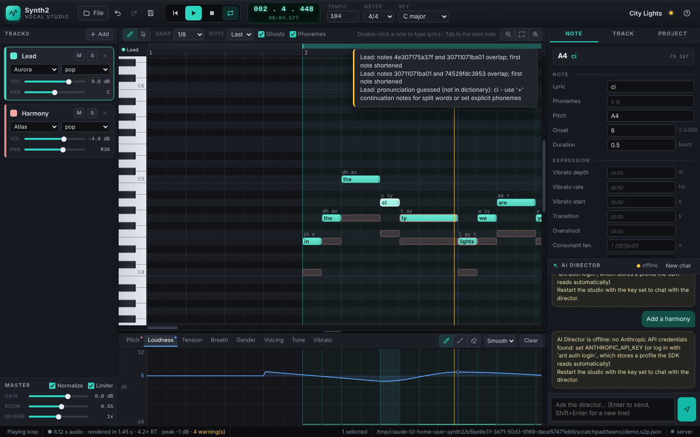

# Synth2 Vocal Studio

**An AI-native singing voice synthesizer and vocal production studio.**

Synth2 does the job of a desktop vocal synthesizer such as Synthesizer V
Studio: write notes and lyrics, shape the performance (pitch, vibrato,
dynamics, tension, breathiness, gender), arrange several vocal tracks, mix,
and render finished vocals to WAV. Every studio capability is also exposed
as **structured tools**, so an AI model can design, perform and produce full
vocal tracks at the same level a human does in the editor. The AI can also
check its own output with built-in audio analysis.

```
            Web studio (piano roll)    CLI    MCP server    AI Director (Claude)
                         \               |         |              /
                          +------ synth2.ai.tools (one tool layer) -----+
                                         |
       project model  ·  score notation  ·  SVP / MIDI / MusicXML / UST  ·  engine
                                                                             |
   lyrics → phonemes → timing planner → expression → singing engine → mixer → WAV
                                                      formant | neural      + band
```

> **Two singing engines.** The built-in **formant** engine is a fast
> parametric singer (a pulse-synchronous source-filter vocoder with
> formant-synthesized vocal tracts): always available, numpy only, clearly
> synthetic, somewhere between a classic vocaloid and a formant synth. The
> optional **neural** engine runs a DiffSinger voicebank and a neural vocoder
> on `onnxruntime`: a natural voice with intelligible words, at about real
> time on a laptop CPU. Its models are not part of Synth2: `synth2 models
> install` downloads them from their publishers, and each has its own licence
> and credit line (see [Credits](#credits-and-licences)). Both engines sit
> behind one interface, so projects, tools and the studio are the same for
> both. The neural engine's settings were chosen with speech recognisers,
> level measurements and one round of listening;
> [`docs/NEURAL.md`](docs/NEURAL.md) has the details and what is known to be
> missing.



## Features

| Area | What you get |
|---|---|
| **Editing** | Notes with pitch, timing and lyrics. Per-note phoneme override and expression attributes (vibrato depth, rate and start, transition time, overshoot, consonant length, tension, breathiness, detune, velocity, language). Multiple tracks. Tempo map. Time signature and key. Undo and redo. |
| **Lyrics** | English (CMU dictionary plus letter-to-sound fallback, automatic syllable splitting across notes) and Japanese (kana or romaji). `-` melisma, `+` word continuation, `br` breath, `[s t aa r]` explicit phonemes. |
| **Automatic expression** | "AI tuning" styles (`pop`, `ballad`, `rock`, `jazz`, `rnb`, `soft`, `classical`, `robotic`, `flat`). Portamento with preparation and overshoot, phrase scoops and falls, delayed natural vibrato, pitch drift, phrase dynamics, pitch-dependent tension, automatic breaths. |
| **Parameter lanes** | `pitchDelta` (cents), `loudness` (dB), `tension`, `breathiness`, `gender`, `voicing`, `toneShift`, `vibratoEnv`, with linear, cubic or step interpolation. |
| **Singing engines** | `formant` (built in) and `neural` (a DiffSinger voicebank, installed with `synth2 models install`). Chosen per project, per track or per render: `auto`, `formant`, `neural`, `neural:<voicebank id>`; `auto` uses the neural engine when it is installed. Quality presets `draft`, `normal`, `high` for the neural engine. See [Singing engines](#singing-engines). |
| **Voices** | `aurora` (bright female pop), `seraph` (soft breathy female), `atlas` (male tenor), `ember` (warm baritone), `nova` (synthetic vocaloid-style idol), `pixel` (young, high), `basso` (bass). Each can be tweaked per track, and custom voices can be loaded from JSON. On the neural engine every voice is the installed voicebank shifted into that character (`synth2 voices` shows how). |
| **Vocal roles** | A track can say what it is in the mix: `lead`, `double`, `harmony`, `answer`, `adlib`, `crowd`. The neural engine sings each role differently (a double is made from the lead's own take, an ad-lib track is sung hit by hit) and the mixer places it. An articulation dial (`neural.dial`: smooth, balanced, crisp) and breaths between lines are per-track settings. |
| **Backing band** | `synth2/arranger`: a numpy instrument engine (drum kits, basses, power-saw "guitars", chiptune and supersaw leads, plucks, pads, bells, sci-fi FX) driven by a JSON arrangement of sections, chords per bar, step patterns, riffs, fills, events and stops. Stored in the project and editable through the `set_backing`, `get_backing` and `clear_backing` tools. See [`synth2/arranger/FORMAT.md`](synth2/arranger/FORMAT.md). |
| **Sampled instruments** | Any band instrument or drum kit can play samples instead of the synth: an installed sound set (`synth2 sounds install`), a SoundFont 2 file, an SFZ instrument or a folder of your own WAV files. A sound that is missing never fails a render: the synthesised instrument plays and the render says so. See [Sampled instruments](#sampled-instruments). |
| **Mixing and mastering** | `synth2/engine/mixing.py`: vocal chain (HPF, presence, compression, reverb, tempo-synced delay), role-based band EQ, kick sidechain ducking, vocal-aware band ducking, glue compression, BS.1770 loudness metering, true-peak limiter with a LUFS target. Gain, pan, mute and solo per track, with per-track and per-instrument stems. |
| **AI** | A tool layer with JSON schemas, an MCP server for Claude Desktop, Claude Code and other clients, a Claude-powered **Director** that turns natural language into productions, a compact score language for writing songs, harmony generation, and objective render checks (pitch accuracy in cents, levels, clipping, voicing). |
| **Interop** | Import and export of Synthesizer V `.svp`, MIDI (with lyric events), MusicXML and `.mxl`, UTAU `.ust`, Synth2 JSON and score text. |
| **Studio GUI** | A browser studio with a canvas piano roll, parameter lane drawing, inspector, mixer, transport with playback, engine and quality selectors, a status badge for the neural engine, track roles, the credits of the last render, and an AI chat panel. |

## Showcase: SELECT ALL INVADERS

`examples/select_all_invaders/` is a complete 3:11 song made entirely in the studio by a team of AI agents. It is a Pinocchio-P-style vocaloid track about an AI defending Earth from aliens with CAPTCHAs, cookie banners and terms of service. It has:
- 20 vocal tracks: the AI lead (Nova), alien voices, a human crowd, doubles and harmonies
- a full synthesized band with a key change and a glitch bridge
- a master at -11.5 LUFS

```bash
python examples/select_all_invaders/build.py            # full song -> out/select_all_invaders/
python examples/select_all_invaders/build.py --start-bar 33 --end-bar 49   # just chorus 1
```

It includes the spec (`SPEC.md`), the lyrics, the vocal score (`vocals.s2s`), the band arrangement (`backing.json`) and the production script.

## Install

```bash
pip install -e .            # numpy + cmudict: the formant engine, the band, the studio
pip install -e ".[ai]"      # + anthropic SDK for the AI Director
pip install -e ".[neural]"  # + onnxruntime and PyYAML for the neural engine
synth2 models install       # the default voicebank and its vocoder (about 470 MB)
synth2 sounds install generaluser-gs avl-drumkits   # optional: sampled band instruments and drums
```

Python 3.10 or newer. No GPU is needed. The formant engine renders several
times faster than real time on a laptop CPU, the neural engine at about real
time. `synth2 models install` and `synth2 sounds install` show each licence
and ask before they download; the files go into a per-user folder
(`synth2 models path`, `synth2 sounds path`), never into the repository.
Without the models everything still works with the formant engine, and
`synth2 engines` says what is missing.

## Quick start

```bash
synth2 engines                              # which engines can run here, voicebanks, credits
synth2 demo -o out/demo                     # render the bundled demo songs
synth2 render examples/neon_hearts.s2s -o out/neon.wav --check
synth2 render examples/neon_hearts.s2s -o out/neon.wav --engine neural --quality draft
synth2 studio --open                        # web studio on http://127.0.0.1:8765
synth2 phonemize "twinkle twinkle little star"
synth2 voices && synth2 styles
synth2 convert song.svp song.s2s            # Synthesizer V -> score notation
```

`render` prints a JSON report on stdout and, on stderr, which engine sang,
the credits to show when you publish the audio and any warnings.

### Score notation (what an AI writes)

```text
title: Neon Hearts
tempo: 112
time: 4/4
key: C major

track: Lead voice=aurora style=pop lang=en
r w
E4 e city  E4 e +  G4 q lights  G4 e are  A4 e calling  G4 e +  E4 e out  D4 e my | E4 h. name  r e
C5 q neon{tension=0.3}  B4 e +  G4 q. hearts  r e  A4 e we | C5 q light  D5 e up  C5 e the  E5 h sky{vibrato_depth=0.45}
```

A note is `PITCH DURATION LYRIC[{attr=value,...}]`. Durations are `w h q e s t`,
with dots (`q.`), triplets (`e3`), ties (`h+q`) or plain beat numbers.
`r DUR` is a rest and `|` is a visual bar line. A header line `engine: neural`
and the track options `engine=`, `role=` and `voice.neural.<name>=` choose the
engine and the roles (see [Singing engines](#singing-engines)). See
`docs/PLAN.md` for the full grammar and `examples/` for complete songs.

### Python

```python
from synth2 import Project, render_project
from synth2.phonemes import split_lyrics

p = Project.new("Demo", bpm=100, voice="atlas")
lead = p.tracks[0]
for i, (pitch, lyric) in enumerate(zip(["C4", "E4", "G4", "E4"], split_lyrics("hello my friend"))):
    lead.add_note(1 + i, 1, pitch, lyric)
lead.curve("tension").add(1, 0.0)
lead.curve("tension").add(5, 0.6)

result = render_project(p)                      # engine="neural", quality="draft" choose for one render
result.save("demo.wav")
print(result.report["engines"], result.report.get("credits", []))
```

## Singing engines

```bash
synth2 engines            # engines, what is installed, licences and credits (--json for machines)
synth2 models list        # installed models and the ones the registry offers
synth2 models install     # download the default voicebank and vocoder (asks you to accept the licences)
synth2 voices             # the voices, and what each becomes on the neural engine
```

Which engine sings a track is decided in this order: the engine of the render
(`synth2 render --engine ...`, the `engine` argument of the `render` tool and
of `/api/render`), the track's own engine, the project's engine, the
`SYNTH2_ENGINE` environment variable. Each is `auto`, `formant`, `neural` or
`neural:<voicebank id>`. With nothing set, or `auto`, the neural engine sings
when it is installed and the formant engine when it is not. Asking for
`neural` by name on a machine without the models is an error that names the
install command (exit status 2 on the command line); it never falls back
silently.

| Where | How |
|---|---|
| Command line | `--engine` and `--quality` on `render`, `demo`, `studio`, `mcp` and `director` (for the last three it is the default of the session) |
| Score | header line `engine: neural`; track options `engine=formant role=harmony voice.neural.dial=1` |
| AI tools | `list_engines`; `engine` on `new_project`, `update_project`, `add_track`, `update_track` and `render`; `quality` on `render` |
| Web studio | the Engine and Quality selectors in the top bar, Engine in the Track tab, the badge that shows whether the neural engine is installed |
| Python | `render_project(project, engine="neural", quality="high")`, `project.engine`, `track.engine` |

`--quality draft | normal | high` trades render time for quality on the
neural engine (5, 10 or 20 diffusion steps); the formant engine ignores it.

Things to know when writing for the neural engine:

- **One track, one kind of singing.** Give tracks a role: `lead`, `double`,
  `harmony`, `answer`, `adlib`, `crowd`. Ad-libs (shouts, laughs, "hey") go on
  their own track with `role=adlib`; a double is a copy of the lead's notes
  with `role=double`, and is made from the lead's take.
- **Fast lyrics are not understood.** Above about 3.5 syllables per second
  the words blur; `check_project` flags such passages.
- **The voicebank is one singer.** The seven voices are that singer with a
  different formant shift; the low voices are sung an octave up inside the
  model. The default voicebank's languages are Chinese, Japanese and English.
- **Articulation and breaths** are per track: `neural.dial` (0 smooth, 1
  balanced, 2 crisp, the default) and `neural.breaths` (0 = none) in the
  track's voice parameters.

The full contract, every `neural.*` parameter, the roles and what is not
implemented are in [`docs/NEURAL.md`](docs/NEURAL.md).

## Sampled instruments

```bash
synth2 sounds list                                   # installed sets and what the registry offers
synth2 sounds install generaluser-gs avl-drumkits    # a General MIDI soundfont and an acoustic drum kit
synth2 sounds add ~/Music/MyKit                      # a folder of your own WAV files, registered in place
synth2 sounds add ~/sf2/NicePiano.sf2 --id nice-piano --credit "Piano: recorded by A. Player"
synth2 sounds remove nice-piano
```

An instrument of the backing band plays samples when it names a `sound`: the
id of an installed set, or the path of a `.sf2` file, an `.sfz` instrument or
a folder of WAV files (`kick.wav`, `snare_v2.wav`, `Piano_C#4.wav` ...).

```json
"instruments": {
  "bass":  {"preset": "bass_pick", "sound": "generaluser-gs"},
  "keys":  {"preset": "piano", "sound": {"set": "generaluser-gs", "preset": "Bright Grand Piano"}},
  "drums": {"type": "drums", "kit": "rock", "sound": "avl-drumkits"},
  "mine":  {"preset": "pluck", "sound": "samples/MyHarp"}
}
```

`preset` stays the synthesised instrument: it plays, with a warning in the
render report, when the sound is not installed on the machine that renders.
The `list_sounds` tool and `GET /api/sounds` show what is installed and which
presets a set has. The format is in
[`synth2/arranger/FORMAT.md`](synth2/arranger/FORMAT.md) ("Sampled sounds"),
the sets, their licences and how to add your own in
[`docs/SOUNDS.md`](docs/SOUNDS.md).

## Credits and licences

Synth2 itself is MIT. The voicebank, the vocoder and the sound sets are not
part of it and keep their publishers' terms. Every render says what it used:
the command line prints the lines, the `render` tool returns `credits` and
`licence_notes`, the web studio shows them in the status bar and when you
download the WAV.

- **Show the credit lines when you publish audio.** For the default models
  they are:
  `Vocals: AI-synthesised singing voice, voicebank 绮萱 (Qixuan) v2.7.0 (voice provider 颜绮萱, DiffSinger Community), synthesised with DiffSinger (OpenVPI).`
  and
  `Vocoder: PC-NSF-HiFiGAN (DiffSinger Community Vocoder Project, OpenVPI Team), CC BY-NC-SA 4.0.`
  plus one line per sound set the band played (`synth2 sounds list`).
- **The default vocoder is licensed CC BY-NC-SA 4.0: non-commercial use
  only.** Synth2 says so as a licence note on every neural render. The
  voicebank's own terms allow commercial use and ask that works state the
  vocals are AI-synthesised; they forbid some kinds of content and using the
  output to train voice models. `synth2 engines` prints the terms.
- Sound sets differ: `synth2 sounds list` prints each licence and the
  publisher's own sentence on commercial use. Models and sounds you add
  yourself (`synth2 models add`, `synth2 sounds add`) carry whatever licence
  you got them under; Synth2 cannot know it.
- A render with the formant engine and synthesised instruments needs no
  credits.

## AI integration

Every studio operation is a tool with a JSON Schema and a description written
as the AI's manual. One tool layer (`synth2/ai/tools.py`) backs the MCP
server, the Claude Director, the web studio's REST API and the demo scripts.
Anything a person can do in the editor, an AI can do through the tools.

| Group | Tools |
|---|---|
| Inspect | `get_project` (summary, full JSON or score text), `get_notes`, `list_voices`, `list_engines` (engines, what is installed, licences, roles), `list_styles`, `list_phonemes`, `list_parameters`, `phonemize`, `check_project` (lints for overlaps, out-of-range notes, guessed pronunciations, bad word splits, an engine that is not installed, lines too fast for the neural engine, missing sampled sounds) |
| Project | `new_project` (optionally from a whole score), `update_project`, `set_tempo`, `save_project`, `load_project`, `export`, `undo`, `redo` |
| Tracks | `add_track`, `update_track` (voice, style, engine, role, voice parameters), `remove_track`, `duplicate_track` |
| Notes | `write_melody` (score snippet), `add_notes`, `edit_notes`, `delete_notes`, `set_lyrics`, `transpose`, `quantize` |
| Performance | `apply_expression` (style plus overrides plus per-note attributes), `set_curve`, `clear_curve`, `add_harmony` (diatonic, key-aware, range-fitted) |
| Band | `set_backing`, `get_backing`, `clear_backing`, `list_sounds` (installed sampled instruments and their presets) |
| Output | `render` (WAV, beat range, track subset, stems, engine, quality; returns the engines that sang, the credits and licence notes), `analyze_render` (pitch accuracy per note in cents, levels, clipping, voicing) |

The intended AI workflow is the producer's loop:

1. Plan the structure.
2. Write the melody with `write_melody` and the lyrics.
3. Pick the voice and style.
4. `check_project`.
5. `render`.
6. `analyze_render`.
7. Fix what the numbers say, then render again.

### MCP server (Claude Desktop, Claude Code and other MCP clients)

```bash
claude mcp add synth2 -- synth2 mcp --project ~/songs/my_song.s2p.json --autosave   # Claude Code
```

For Claude Desktop, put this in `claude_desktop_config.json`:

```json
{
  "mcpServers": {
    "synth2": { "command": "synth2", "args": ["mcp", "--project", "/path/to/song.s2p.json", "--autosave"] }
  }
}
```

The server is dependency-free JSON-RPC over stdio. Then just ask: *"Write a
melancholic synth-pop chorus about city lights for Aurora, add a third-below
harmony with Atlas, render it and make sure every note is within 25 cents."*

### AI Director (built-in Claude agent)

```bash
pip install -e ".[ai]" && export ANTHROPIC_API_KEY=...
synth2 director "Compose a 16-bar upbeat J-pop chorus in A major for Nova, double it an octave lower with Pixel" --project song.s2p.json
synth2 director --project song.s2p.json          # interactive session
```

The Director runs an agentic tool-use loop over the same tools, with a
system prompt covering vocal-production practice: singable ranges, phrase
breathing, syllable-to-note mapping, and the render-and-check loop. The same
assistant is available in the web studio's **AI Director** panel. It
defaults to the latest Claude model; override it with `SYNTH2_MODEL`.

### Python

```python
from synth2.ai.tools import Session, call_tool

s = Session()
call_tool(s, "new_project", {"title": "Demo", "bpm": 96, "voice": "seraph", "key": "D major"})
call_tool(s, "write_melody", {"track": 0, "score": "r w  D4 q hello D4 q +  F#4 h world  A4 h. tonight"})
call_tool(s, "apply_expression", {"track": 0, "style": "ballad"})
call_tool(s, "add_harmony", {"source_track": 0, "steps": -2, "voice": "ember"})
out = call_tool(s, "render", {"path": "out/demo.wav", "quality": "draft"})
print(out["engines"], out["credits"], out["licence_notes"])
print(call_tool(s, "analyze_render", {}))
```

### Web studio API

`synth2 studio` serves the page and a small REST API on the same port:
`GET /api/engines` (engines, voicebanks, credits, roles), `GET /api/sounds`
(installed sound sets), `POST /api/render` with `{"engine": ..., "quality":
..., "start_beat": ..., "end_beat": ...}` (WAV; the report with engines,
credits and licence notes is in the `X-Render-Report` header and at
`GET /api/render/report`), `GET /api/render/status` (progress of a running
render) and `POST /api/tool` for every tool. An engine that is not installed
answers 409 with the install command. Renders run one at a time and do not
block the other requests.

## Architecture

| Module | Role |
|---|---|
| `synth2/project.py` | Project, Track, Note, Curve model and JSON serialization (time in beats) |
| `synth2/phonemes/` | Phoneme inventory with acoustic targets, English and Japanese G2P, lyric resolution |
| `synth2/voices/` | Parametric singer presets and custom voice loading |
| `synth2/engine/planner.py` | Notes and lyrics to timed phoneme segments (vowel on the beat, consonants before it) |
| `synth2/engine/expression.py` | Automatic pitch and dynamics performance styles |
| `synth2/engine/params.py` | Segments to frame-level formant, voicing and noise tracks, with coarticulation |
| `synth2/engine/vocoder.py` | Pulse-synchronous minimum-phase harmonic synthesis, plus HNR-shaped breath, aspiration and frication noise |
| `synth2/engine/renderer.py` | Track rendering, mixing, reverb, limiter, stems and render reports |
| `synth2/engine/backend.py` | Voice backend interface and engine selection (`auto`, `formant`, `neural`) |
| `synth2/engine/mixing.py`, `vocal_chain.py` | Channel strips, band bus, mastering; the chains of the vocal roles |
| `synth2/neural/` | The neural engine: DiffSinger voicebanks on `onnxruntime`, the model installer (`synth2 models`) |
| `synth2/arranger/` | The backing band: synthesised instruments and the sample player (SoundFont 2, SFZ, WAV folders) |
| `synth2/sounds/` | Sound sets: registry and installer (`synth2 sounds`) |
| `synth2/analysis.py` | YIN pitch tracking, level analysis, pitch accuracy versus the score |
| `synth2/score.py` | Text score notation, parse and serialize |
| `synth2/io/` | WAV, SVP, MIDI, MusicXML and UST |
| `synth2/ai/` | Tool registry, composer helpers, MCP server, Claude Director |
| `synth2/server/` | Web studio, REST API and static frontend |

## Development

```bash
pip install -e ".[dev,ai]"
pytest -q
```

## License

MIT
